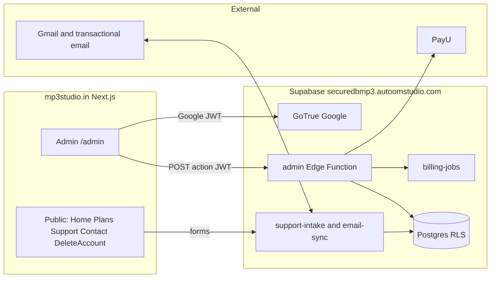

# MP3 Studio: Web Admin Dashboard PRD

**Scope:** Website Admin dashboard that replaces the in-app Android Admin and adds full operations (billing recovery, support inbox, emails, GST receipts, website CMS) **Product:** MP3 Studio **Platform:** Web (`mp3studio.in`, Next.js) talking to the existing self-hosted Supabase backend **Status:** Draft **Date:** 2026-10-21

---

## 1. Overview

MP3 Studio already has accounts, plans, PayU payments and a complete **in-app Admin** (PRD v3.2 M5, payments PRD AD1–AD5). v3.2 deferred a web dashboard. This document replaces that decision.

The owner and authorized Admins will run the product from a website dashboard on [mp3studio.in](https://mp3studio.in/). The Android Admin screens are removed once the website has parity and the new ops tools. The server remains the source of truth: every privileged action still goes through `assert_admin()` and the `admin` Edge Function.

What this dashboard is for:

- **Look up and act on users** — plan, trial, PayU and admin subscriptions, usage, payments, disable, grant or remove Pro, delete an account on a verified request.
- **Run billing** — payment list, re-check with PayU, full and partial refunds, receipts and GST invoices, webhook and cron-job recovery.
- **Answer customers** — one inbox for the Contact / Support / Delete Account forms on [mp3studio.in](https://mp3studio.in/) and emails sent to `mp3studio.in@gmail.com`, with the matching user and payment history beside the ticket.
- **Send billing mail** — receipts, failed-renewal and expiry notices (today only logged).
- **Edit the public site** — Play listing vs “Coming soon”, FAQ and help articles, announcement banner, legal pages.

Music, playlists, stems and recordings never leave the phone. The dashboard never sees song files. `ai_usage.song_ref` is only the title the app already stores.

## 2. Problem Statement

The in-app Admin works on a phone, but day-to-day ops do not: refunds, webhook retries, GST paperwork, support replies and website copy need a keyboard, a large screen and tools the Android UI never grew (retry a flagged webhook, run a billing job, reply to email, issue a receipt). Support and delete-account requests already land on [mp3studio.in](https://mp3studio.in/) and Gmail with no queue. Billing notices are only logged. The marketing site still has `[to confirm: …]` placeholders and a “Coming soon” Play button that will need a one-click flip at launch.

Keeping Admin only inside the app also means a demoted or stolen phone session is the only desk the owner has. A website signed in with the same Admin Google accounts, checked on every call, is the right place to run the business.

## 3. Goals and Non-Goals

**Goals**

- Give every enabled Admin a website that can do everything the Android Admin can do today, plus the ops gaps listed in section 6.
- Keep one Admin role. Anyone who can sign in can do everything. The last enabled Admin cannot be demoted or disabled; an Admin cannot disable themselves.
- Reuse the live Supabase project (`https://securedbmp3.autoomstudio.com`), the `admin` Edge Function and `assert_admin()`. Do not give the website the service-role key.
- Unify Contact, Support and Delete Account form submissions with inbound mail at `mp3studio.in@gmail.com` into one ticket queue, linked to the matching profile when the email matches.
- Send and log billing emails; let an Admin preview, resend and download a receipt or GST invoice.
- Let an Admin change public site copy (FAQ, help, Play / Coming soon, banner, legal pages) without a code deploy.
- Remove the Android Admin screens after the website is the daily tool (Phase 3). Server functions stay.

**Non-Goals**

- A public customer account area on the website (plans, checkout, library). Users stay in the Android app.
- Extra staff roles (Owner / Billing / Support). One `admin` role.
- Uploading, streaming or inspecting users’ music or recordings.
- Replacing PayU, adding coupons, referral credit or a new price that is not already on the server (`₹99` / `₹999` INR, `$1.99` / `$19.99` USD).
- Changing how the Android app gates features, claims trials or talks to PayU, except deleting the Admin UI in Phase 3.
- A live chat widget, WhatsApp Business inbox, or phone-call logging. WhatsApp and the published phone number stay as published contact details; tickets are form + email.
- Letting a non-admin sign in to `/admin`. There is no guest dashboard.

## 4. Target Users

- **Admins:** The owner and people whose `profiles.role` is `admin` and `profiles.disabled` is false. They sign in with the same Google account they use (or will use) in the app. The first Admin is still created with [`supabase/seed/first_admin.sql`](supabase/seed/first_admin.sql); later Admins are invited from the dashboard.
- **End users** do not use this product. They only appear as rows, tickets and payments. They keep using the Android app and the public pages on [mp3studio.in](https://mp3studio.in/).

## 5. Platform and Technical Decisions

| Area | Decision |
| --- | --- |
| Host | [mp3studio.in](https://mp3studio.in/) (existing Next.js site). Admin lives at `https://mp3studio.in/admin` (or `admin.mp3studio.in` if the host prefers a subdomain). Same origin as Contact, Support and Delete Account so those forms can post into the same backend |
| Auth | Google OAuth through the existing GoTrue project. No email-and-password Admin login. After Google, the site calls `entitlements` or `is_admin()` and refuses anyone who is not an enabled Admin |
| API | `POST /functions/v1/admin` with the Admin’s JWT, same `{ action, … }` contract the app uses today, plus the new actions in section 7.2. The browser never holds the service-role key or PayU secrets |
| Server checks | Every mutation still starts with `assert_admin(p_actor)` in Postgres. The website `isAdmin` flag only decides whether to show the shell |
| Session | Supabase session in an httpOnly cookie (or the official supabase-js browser client with a short-lived access token). A 403 `forbidden` signs the Admin out and shows “Admin access was removed” |
| Role model | Single `app_role`: `user` / `admin`. No new enum values |
| Time and money | Amounts in paise (INR) or cents (USD) as integers. Server times UTC. Dashboard dates in the Admin’s local time, with IST noted on weekly usage (`usage_week_start`) |
| Email | Inbound: sync `mp3studio.in@gmail.com` (Gmail API or IMAP) into `support_messages`. Outbound replies and billing mail: the same mailbox or a dedicated transactional sender, behind a server interface so the provider can change |
| GST | Invoice fields (GSTIN, legal name, address, SAC/HSN, tax rate, inclusive vs exclusive) are Admin-editable settings. Confirm with a tax adviser before turning GST invoices on (payments PRD CP4). USD payments get a receipt, not an Indian tax invoice, unless an adviser says otherwise |
| Secrets | PayU, `TRIAL_HASH_PEPPER`, `BILLING_JOBS_SECRET`, Gmail OAuth refresh token and SMTP keys stay in the functions / Coolify environment and Vault. The website only sees booleans such as `paymentsEnabled` and `payuEnv` (`test` / `live`) |
| Existing Admin API | Keep and extend. Do not build a second privileged API. New SQL functions follow the same `p_actor` + `admin_log()` pattern |
| Android Admin | Removed in Phase 3. Until then both UIs may call the same function. After Phase 3, `ui/admin/*` and `data/admin/*` go; `assert_admin` and `admin_*` stay |

## 6. Existing System (do not rebuild)

The dashboard is a new client of what already ships. See [docs/features/admin.md](docs/features/admin.md), [docs/backend.md](docs/backend.md) and [docs/features/payments.md](docs/features/payments.md).

| Already exists | Dashboard uses it for |
| --- | --- |
| `profiles.role`, `is_admin()`, `assert_admin()` | Who can open `/admin` and call any action |
| `admin` Edge Function actions: `overview`, `users`, `user`, `setRole`, `setDisabled`, `addAdmin`, `revokeInvite`, `grantPro`, `revokePro`, `admins`, `usage`, `audit`, `activity`, `payments`, `billingHealth`, `reverifyPayment`, `refundPayment`, `cancelSubscription`, `revokeSubscription` | Phase 1 parity |
| `admin_overview`, `admin_list_users`, `admin_user_detail`, `admin_usage`, `admin_list_admins`, `admin_audit`, `admin_activity`, `admin_list_payments`, `admin_billing_health`, `admin_billing_action` | Same payloads; extend rather than replace |
| Refusals `last_admin`, `self`, `invalid_email`, `invalid_date`, `not_refundable`, `not_subscribed`, `payu_refused`, `payu_unavailable` | Same snackbars / dialogs on the web |
| Admin Pro grant (`provider = 'admin'`, end date ≤ 5 years) | Grant / Change / Remove Pro |
| PayU payments, mandates, refunds, disputes, five `pg_cron` jobs | Payments, health, refunds |
| `ai_usage` weekly reset Monday IST, Free 10 / week | Usage module |
| `delete_account()` (mandate cancel first, keeps `trial_claims` and payments) | Admin-initiated delete after a verified request |
| [mp3studio.in](https://mp3studio.in/) Support, Contact, Delete Account, FAQ, Plans (₹99 / ₹999), legal pages | CMS source of truth and support form targets |

**Known gaps the website must close** (from the feature docs):

- Billing health only reports; there is no retry-flagged-webhook button.
- Refunds from Admin are full remaining amount only; partial refunds are done in the PayU dashboard.
- Billing emails are `LogNotifier` only.
- GST invoices are out of scope in the payments PRD (phase 6).
- Activity unread is per phone, not per Admin.
- Phone notifications depend on the app being installed.

## 7. Functional Requirements

Priority: **P0** = must ship in that phase, **P1** = should ship, **P2** = nice to have.

### 7.1 Admin authentication and session (`AU`)

| ID | Requirement | Priority | Phase |
| --- | --- | --- | --- |
| AU1 | `/admin` is reachable only after Google sign-in against the existing Supabase project | P0 | 1 |
| AU2 | After sign-in, the server confirms `role = admin` and `disabled = false`. Anyone else sees “Access denied” and is signed out. The website never trusts a client-only flag | P0 | 1 |
| AU3 | A 403 `forbidden` on any admin call signs the session out and shows “Admin access was removed” (same as the app) | P0 | 1 |
| AU4 | The first Admin is still created in the database (`first_admin.sql`), never by self-serve sign-up on the website | P0 | 1 |
| AU5 | Sign-out clears the website session only. It does not sign the same Google account out of the Android app | P0 | 1 |
| AU6 | Session cookies are `Secure`, `HttpOnly` and `SameSite=Lax` (or the official supabase-js equivalent). Admin pages are `no-store` | P0 | 1 |
| AU7 | Optional: remember “last seen activity” per Admin on the server so unread is shared across browsers | P1 | 1 |

### 7.2 Executive overview and activity (`OV`)

| ID | Requirement | Priority | Phase |
| --- | --- | --- | --- |
| OV1 | Home shows counts: total users, Pro, Trial, Free, Disabled, Admins, this week’s completed / reserved / denied separations (`admin_overview`) | P0 | 1 |
| OV2 | Pro count can be split by interval (`month` / `year`), currency (`INR` / `USD`) and source (`payu` / `admin` grant) | P1 | 1 |
| OV3 | Home shows open support tickets and a billing-health summary (overdue jobs, flagged webhooks, pending mandate cancels, events to review). Each card opens the matching page | P0 | 2 for tickets; 1 for billing |
| OV4 | Home shows approximate MRR / ARR in INR and USD from live PayU Pro rows (active / past_due / cancelled-with-time-left), using the server price for that interval and currency. Admin grants do not count as revenue | P1 | 1 |
| OV5 | Home shows new subscriptions vs cancellations / expiries (30 days and 12 weeks) and trial-to-Pro conversion (users who had a trial and later a successful PayU payment) | P1 | 1 |
| OV6 | Activity feed: existing `signup`, `subscribed`, `deleted` events, plus `ticket_opened` and `payment_failed` once those sources exist. Newest first, default 50, cap 100 | P0 | 1 (existing types); 2 (ticket) |
| OV7 | Unread badge on Activity. Opening the feed marks it seen. Browser notification permission is optional; email of new events is P2 | P1 | 1 |
| OV8 | While the dashboard tab is visible, the current page refreshes quietly every 30 seconds. A failed refresh keeps the data already shown. Manual refresh and a “Last updated” time are always available | P0 | 1 |

### 7.3 Users and entitlements (`US`)

| ID | Requirement | Priority | Phase |
| --- | --- | --- | --- |
| US1 | User list: search email, display name, phone or user UUID (debounce ~300 ms). Filters: All, Pro, Trial, Free, Disabled, Admins. 50 per page, Load more | P0 | 1 |
| US2 | Extra filter: currency / region (`INR`, `USD`, none) for users with a live or last subscription | P1 | 1 |
| US3 | Rows show initials or avatar, name, email, plan, this week’s completed separations, Admin and Disabled badges | P0 | 1 |
| US4 | Export the current filter as CSV (id, email, name, role, plan, disabled, created_at, used_this_week). Cap and rate-limit the export | P1 | 1 |
| US5 | User 360: avatar, name, email, phone, copyable user id, joined date, role chip, plan pill, Disabled chip | P0 | 1 |
| US6 | Plan card: effective plan from `compute_entitlements` / `plan_of`, status, PayU or Admin source, Monthly / Yearly, currency, Renews on / Ends on, payment status | P0 | 1 |
| US7 | Trial card: start, end, claim result if known. Actions: Grant trial (30 days from now if they have none), Extend trial (new end date, future, ≤ 1 year), Reset trial (delete `trials` row and matching `trial_claims` for that user so the next `entitlements` refresh can claim again). Confirm + audit `grant_trial` / `extend_trial` / `reset_trial`. Use for pepper-loss and support cases; do not advertise as a normal entitlement | P0 | 1 |
| US8 | Subscriptions list: every `payu` and `admin` row — status, interval, currency, autopay, mandate ref, mandate start / end, grace end, next billing, cancel-at-period-end, cancel pending | P0 | 1 |
| US9 | Actions (all confirmed, all audit-logged, same refusals as today): Make / Remove Admin (`setRole`); Grant / Change Pro (1 month, 3 months, 1 year, or date ≤ 5 years, `grantPro`); Remove Admin Pro (`revokePro`); Cancel PayU at period end (`cancelSubscription`); Revoke PayU now (`revokeSubscription`, no refund); Disable / Enable (`setDisabled`). Hide Disable on your own page | P0 | 1 |
| US10 | Admin-initiated delete: after a verified Delete Account form or support ticket, cancel any live mandate, then `delete_account()`. Audit `admin_delete_account`. Refuse `last_admin` and `mandate_cancel_failed` with the same copy as the app. Type `DELETE` to confirm | P0 | 2 |
| US11 | Usage on the user page: this week used / reserved / remaining, last 8 weeks chart, last 50 jobs (`jobRef` copyable, `songRef`, status, times) | P0 | 1 |
| US12 | User payments (latest first) and payment events, with Re-check and Refund. “See all” opens Payments filtered by that email | P0 | 1 |
| US13 | User support history: tickets and mail from that email (Phase 2) | P0 | 2 |
| US14 | Acting on yourself (role or own Pro) refreshes the website session entitlements immediately | P0 | 1 |

### 7.4 Payments, refunds and receipts (`PY`)

| ID | Requirement | Priority | Phase |
| --- | --- | --- | --- |
| PY1 | Payment list: search email, `txnId`, PayU ref or mandate ref. Filters: All, Paid, Failed, Pending, Refunded, Partially refunded, Disputed, Past due, Cancelled. 50 per page | P0 | 1 |
| PY2 | Extra filters: currency, interval, kind (`first` / `renewal` / `replace`) | P1 | 1 |
| PY3 | Row: user (or “Deleted account”), amount + currency, refunded amount, status, kind, method, PayU ref, refund-in-progress, timestamps | P0 | 1 |
| PY4 | Detail drawer: link expiry, `resolve_until`, mandate ref, failure reason, full `payment_events` for that `txn_id` | P0 | 1 |
| PY5 | Re-check with PayU (`reverifyPayment`): idempotent status / refund check. Show Checked / Unchanged / refund checked | P0 | 1 |
| PY6 | Full refund of remaining amount (today’s rule): paid (or partially refunded), has `payu_ref`, no refund in flight. Confirm dialog. Result `refund_requested`; state changes when PayU confirms | P0 | 1 |
| PY7 | Partial refund: Admin enters amount in paise / cents, less than remaining, optional reason. Same PayU request + sweep / webhook. A partial refund does not expire Pro unless the Admin also revokes or the refund is of the whole current period (existing `apply_refund_result` rule) | P0 | 1 |
| PY8 | CSV export of the filtered list or a date range, for accounts / GST. Columns: txn, email, amount, currency, status, kind, method, payu_ref, refunded, completed_at | P1 | 1 |
| PY9 | Receipt view (transaction id, amount, currency, date, method, user email). Download PDF or print. Resend receipt email | P0 | 2 |
| PY10 | GST tax invoice for INR payments once tax settings are on (EM5). Download PDF and resend. USD: receipt only unless an adviser says otherwise | P1 | 2 |

### 7.5 Billing health, webhooks and jobs (`BH`)

| ID | Requirement | Priority | Phase |
| --- | --- | --- | --- |
| BH1 | Job cards for `webhooks`, `sweep`, `renewals`, `expiry`, `notices`: last run, processed / failed / skipped, last error, overdue (twice the interval with no finish) | P0 | 1 |
| BH2 | Run job now: website asks the `admin` function; the function calls `billing-jobs` with the Vault secret. The browser never sees `BILLING_JOBS_SECRET`. Audit `run_billing_job` | P0 | 1 |
| BH3 | Job run history table from `job_runs` (newest first) | P1 | 1 |
| BH4 | Webhook list from `webhook_log` (redacted body only): filter flagged / failed / received / processed / ignored / hash mismatch | P0 | 1 |
| BH5 | Inspect one webhook: redacted JSON, attempts, next retry, error | P0 | 1 |
| BH6 | Retry webhook now (re-run processing after a PayU status check). Clear flag / acknowledge without reprocessing. Audit `retry_webhook` / `ack_webhook` | P0 | 1 |
| BH7 | Stuck mandates: subscriptions with `mandate_cancel_requested_at` set and not confirmed. Retry mandate cancel. Audit `retry_mandate_cancel` | P0 | 1 |
| BH8 | Needs-review queue: payment events in the last 30 days that the health function already flags (amount / currency / mandate mismatch, open dispute). Mark reviewed | P0 | 1 |
| BH9 | Read-only readiness: `paymentsEnabled`, `PAYU_ENV` (`test` / `live`), `PAYU_BILLING_MODE` (`manual` / `autopay`), whether trial pepper and email provider are configured. Never show secret values | P0 | 1 |

### 7.6 AI Vocal Separator usage (`UA`)

| ID | Requirement | Priority | Phase |
| --- | --- | --- | --- |
| UA1 | Weekly table and chart: last 8 weeks by default, option for 52. Columns: week start (IST Monday), completed, reserved, released, denied, unique users | P0 | 1 |
| UA2 | Top users this week (existing top 20), plus last 30 days and all time. Click opens User 360 | P0 | 1 |
| UA3 | Denied-this-week list (Free users who hit 10 / week) as an upgrade signal | P1 | 1 |
| UA4 | Reserved jobs older than a chosen age but younger than 48 hours (still holding a slot) so an Admin can see stuck phones | P2 | 1 |

### 7.7 Support inbox (`SP`)

| ID | Requirement | Priority | Phase |
| --- | --- | --- | --- |
| SP1 | One ticket queue for (a) `mp3studio.in/contact`, `/support` and `/delete-account` forms and (b) inbound mail to `mp3studio.in@gmail.com` | P0 | 2 |
| SP2 | Form fields: name, email, topic (`billing`, `deletion_request`, `refund_request`, `bug`, `playback`, `separator`, `privacy`, `general`), message, optional txn id. Public pages show a success state; they do not expose Admin UI | P0 | 2 |
| SP3 | Inbound mail becomes a message on an existing ticket when `In-Reply-To` / `References` / subject `[MP3-#id]` matches; otherwise a new ticket. Store `Message-ID` to avoid duplicates | P0 | 2 |
| SP4 | If the sender email matches `profiles.email` (case-insensitive), the ticket sidebar shows plan, trial, last payment, usage and links to User 360, Re-check, Grant Pro, Refund, Admin-delete | P0 | 2 |
| SP5 | Statuses: `open`, `pending_user`, `resolved`, `spam`. Filters by status, topic, unmatched (no profile), assigned-to-me (P2) | P0 | 2 |
| SP6 | Reply from the dashboard sends mail from the support address, prefixes `[MP3-#id]`, and stores the outbound body. Canned templates: payment received, how to cancel autopay, deletion completed, device / format help, “we need your Google email” | P0 | 2 |
| SP7 | Internal notes never go to the customer | P0 | 2 |
| SP8 | Delete Account form creates a `deletion_request` ticket (or a dedicated queue row) and does **not** delete by itself. An Admin verifies the email matches the profile, then runs US10 | P0 | 2 |
| SP9 | Public promise on Contact (“We aim to reply within 2 business days”) is shown as an aging hint on open tickets older than 2 business days | P1 | 2 |
| SP10 | Attachments: store inbound attachments in a private bucket (size cap, no executables). Outbound attachments P2 | P1 | 2 |

### 7.8 Billing email and GST (`EM`)

| ID | Requirement | Priority | Phase |
| --- | --- | --- | --- |
| EM1 | Replace `LogNotifier` with a real sender for: payment receipt, pre-debit notice, renewal failed, grace ending, expired, mandate ending. Same triggers the `notices` job already has | P0 | 2 |
| EM2 | Delivery log: template, recipient, ticket/user/txn, status (`queued`, `sent`, `failed`), provider id, error. Resend from the log or the payment / user page | P0 | 2 |
| EM3 | Template preview with sample data. Edits are versioned and audit-logged (`email_template_update`) | P1 | 2 |
| EM4 | Receipt content: legal name Autoom Studio OPC Pvt. Ltd., address on the site, amount, currency, txn id, date, method, user email. No card / UPI / bank numbers | P0 | 2 |
| EM5 | GST settings (Admin-only): GSTIN, legal name, place of supply default (Odisha), SAC/HSN, rate, whether catalog prices are inclusive. Until an adviser confirms, the toggle “Issue GST invoices” stays off and INR payments get a receipt labelled as such | P0 | 2 |
| EM6 | When GST invoices are on, each successful INR payment gets an invoice number (sequential, gapless in a financial year) and a PDF with taxable value and tax | P1 | 2 |

### 7.9 Website CMS (`CMS`)

Content is stored in `site_content` (or equivalent) and read by the public Next.js pages. Publishing is an Admin action.

| ID | Requirement | Priority | Phase |
| --- | --- | --- | --- |
| CMS1 | Release: toggle “Coming soon on Google Play” vs a live Play URL (and optional APK URL). Public header, hero and footer follow this | P0 | 2 |
| CMS2 | Public version label (e.g. `1.0.0`) shown on the site when set | P1 | 2 |
| CMS3 | FAQ editor for Home and Support (question, answer, order, published). Remove or rewrite the live `[to confirm: …]` lines as part of go-live | P0 | 2 |
| CMS4 | Help-article editor (title, slug, body, steps, published) for the Support page | P0 | 2 |
| CMS5 | Optional site-wide announcement banner (text, link, start / end, on / off) | P0 | 2 |
| CMS6 | Legal pages: Privacy, Terms, Refund and Cancellation, Delete Account. Versioned; previous published text kept. Public pages render the current published version | P1 | 2 |
| CMS7 | Plans page prices are **not** typed in by hand. They come from the same server catalog as `entitlements` (`pricesIn`, `pricesIntl`). CMS may edit surrounding copy only | P0 | 2 |
| CMS8 | Every publish writes `cms_update` to the audit log (key, who, when) | P0 | 2 |

### 7.10 Admins, invites and audit (`AD`, `AL`)

| ID | Requirement | Priority | Phase |
| --- | --- | --- | --- |
| AD1 | Admins page: current Admins (name, email, disabled, “(you)”) and pending invites (email, invited by, date) | P0 | 1 |
| AD2 | Add Admin by email: `promoted`, `already_admin` or `invited` (`admin_invites`). Exact email, case-insensitive, same as today | P0 | 1 |
| AD3 | Revoke a pending invite | P0 | 1 |
| AD4 | The last enabled Admin cannot be demoted or disabled; an Admin cannot disable themselves | P0 | 1 |
| AL1 | Audit log, newest first, page by id: actor email (or “the account owner” for `account_deleted`), action, target, details, time. Click actor / target opens User 360 when the id still exists | P0 | 1 |
| AL2 | Filter by action, actor email, target email, date range | P1 | 1 |
| AL3 | Existing actions stay: `set_role`, `disable`, `enable`, `invite_admin`, `revoke_invite`, `invite_accepted`, `grant_pro`, `revoke_pro`, `reverify_payment`, `refund_requested`, `cancel_subscription`, `revoke_subscription`, `account_deleted` | P0 | 1 |
| AL4 | New actions: `grant_trial`, `extend_trial`, `reset_trial`, `admin_delete_account`, `retry_webhook`, `ack_webhook`, `run_billing_job`, `retry_mandate_cancel`, `mark_reviewed`, `support_reply`, `email_resend`, `email_template_update`, `cms_update`, `gst_settings_update` | P0 | 1–2 as each ships |
| AL5 | CSV export of the filtered audit range | P1 | 1 |
| AL6 | Audit rows are append-only. The website has no edit or delete | P0 | 1 |

### 7.11 Security (dashboard-specific)

| ID | Requirement | Priority |
| --- | --- | --- |
| SE1 | RLS stays on every table. `authenticated` still cannot read `admin_audit_log`, `webhook_log`, `job_runs`, `trial_claims`, `support_*` or `site_content` drafts except through service-role functions | P0 |
| SE2 | The Next.js server and the browser never receive the service-role key, PayU keys, trial pepper or job secret | P0 |
| SE3 | New public form endpoints (`support-intake`) are rate-limited, CSRF-protected or token-checked, and do not reveal whether an email has an account | P0 |
| SE4 | Webhook bodies shown in Admin remain redacted (no cards, UPI ids, salts) | P0 |
| SE5 | Exports (CSV, PDF) are Admin-only, audit-logged and rate-limited | P1 |
| SE6 | Content-Security-Policy on `/admin`; no third-party scripts beyond Google sign-in if required | P1 |

### 7.12 Android decommission (`DC`)

| ID | Requirement | Priority | Phase |
| --- | --- | --- | --- |
| DC1 | Phase 3 ships only after Phase 1 has been used for real ops (users, payments, refunds, grants) | P0 | 3 |
| DC2 | Remove `ui/admin/*`, `data/admin/*` (`AdminBackend`, `AdminActivityWorker`, `AdminNotifications`), Admin card on Profile, DataStore keys `admin_activity_seen_at`, `admin_notifications_enabled`, `admin_activity_notified_at`, and the `admin_activity` notification channel | P0 | 3 |
| DC3 | Do not remove `Entitlements.isAdmin` from the wire format if other code still reads `role`; stop using it to open screens | P0 | 3 |
| DC4 | Keep every `admin_*` SQL function, `admin_invites`, `admin_audit_log` and the `admin` Edge Function | P0 | 3 |
| DC5 | Optional: Profile shows no Admin entry at all (preferred). Do not deep-link the phone to `/admin` unless a later decision wants it | P1 | 3 |
| DC6 | Update [docs/features/admin.md](docs/features/admin.md), [docs/CHANGELOG.md](docs/CHANGELOG.md), [docs/architecture.md](docs/architecture.md) and [docs/README.md](docs/README.md) in the same change | P0 | 3 |

## 8. Backend additions

All new functions are `security definer`, `search_path = ''`, `service_role` only, take `p_actor`, start with `assert_admin(p_actor)`, and write `admin_log()` on mutations.

### 8.1 New or extended `admin` actions

| Action | Maps to | Notes |
| --- | --- | --- |
| Existing actions in [docs/backend.md](docs/backend.md) | unchanged | Website is another client |
| `overview` (extend) | `admin_overview` | Add Pro splits, MRR fields, ticket counts when those tables exist |
| `users` (extend) | `admin_list_users` | Search also matches phone and UUID; optional currency filter |
| `exportUsers` / `exportPayments` / `exportAudit` | new | Return rows or a signed short-lived URL; cap size |
| `grantTrial` / `extendTrial` / `resetTrial` | new | US7 rules |
| `deleteAccount` | wrap `delete_account` after mandate cancel | Same refusals as the user-facing function |
| `webhooks` / `retryWebhook` / `ackWebhook` | new | BH4–BH6 |
| `jobRuns` / `runJob` | `job_runs` + server-side `billing-jobs` | BH2–BH3 |
| `mandateCancels` / `retryMandateCancel` | new | BH7 |
| `reviewQueue` / `markReviewed` | new | BH8 |
| `readiness` | new | BH9 booleans only |
| `usage` (extend) | `admin_usage` | Optional week count; denied list |
| `tickets` / `ticket` / `replyTicket` / `setTicketStatus` / `addTicketNote` | new | SP* |
| `emails` / `resendEmail` | new | EM* |
| `siteContent` / `publishSiteContent` | new | CMS* |
| `gstSettings` | new | EM5 |

### 8.2 New tables (product level)

| Table | Purpose |
| --- | --- |
| `support_tickets` | id, source (`form` / `email`), topic, status, priority, requester name / email, matched `user_id` (nullable), subject, last_message_at, created_at |
| `support_messages` | ticket_id, direction (`in` / `out` / `note`), body, from/to, `message_id`, `in_reply_to`, attachments metadata, actor_id for Admin replies, created_at |
| `support_templates` | canned reply slug, subject, body |
| `email_outbox` | template key, to_email, user_id, txn_id, status, provider_id, error, sent_at |
| `email_templates` | key, subject, body, version, updated_by |
| `gst_settings` | singleton: gstin, legal name, address, sac, rate, inclusive, invoices_enabled |
| `invoices` | invoice_number, payment txn, user_id (nullable after delete), amount, tax, currency, pdf ref, issued_at |
| `site_content` | key (e.g. `faq`, `help`, `banner`, `release`, `legal.privacy`), draft JSON, published JSON, published_at, updated_by |
| `admin_activity_seen` | `admin_id`, `seen_at` — unread shared across devices (AU7) |

`anon` has no access. Public forms insert only through `support-intake`. Ticket and CMS reads for Admin go through RPCs.

### 8.3 New Edge Functions

| Function | Auth | Role |
| --- | --- | --- |
| `admin` (extended) | Admin JWT | All privileged actions |
| `support-intake` | Public, rate-limited | Insert ticket from website forms |
| `email-sync` | Secret header or Google push | Pull Gmail / accept inbound webhook, upsert messages |
| `billing-jobs` | Existing job secret | Unchanged; also invoked by `runJob` on the server |

## 9. User flows

1. **Sign in:** Open `/admin` → Continue with Google → enabled Admin lands on Overview; anyone else is signed out with Access denied.
2. **Lookup:** Overview or Users → search email → User 360 → Grant Pro / Disable / Refund.
3. **Invite Admin:** Admins → Add admin → email → `invited` or `promoted` → audit row. New Google sign-in consumes the invite (`handle_new_user`).
4. **Stuck payment:** Payments → search txn → Re-check with PayU → status updates → optional Refund.
5. **Flagged webhook:** Billing health → Webhooks → open flagged row → Retry → flag clears or error stays visible.
6. **Failed cron:** Billing health → overdue job → Run now → new `job_runs` row.
7. **Support (form):** Customer submits Contact → ticket `open` → Admin replies → mail sent with `[MP3-#id]` → status `pending_user` → inbound reply appends → resolve.
8. **Support (Gmail):** Customer emails `mp3studio.in@gmail.com` → `email-sync` opens or continues a ticket → same reply path. If the email matches a profile, sidebar shows plan and payments.
9. **Delete from the website:** Customer uses Delete Account → `deletion_request` ticket → Admin checks the Google email → type DELETE → mandate cancel → `delete_account` → reply “deleted”.
10. **Launch flip:** CMS → set Play URL → publish → public header and hero stop saying Coming soon.
11. **Demotion:** Another Admin removes your role → next API call is 403 → website signs out.
12. **Phase 3:** After Phase 1 is in daily use, a release of the Android app ships without Admin screens.

## 10. Screens (website)

**Shell:** MP3 Studio wordmark, Admin chip, nav (Overview, Users, Payments, Billing health, Usage, Support, Emails, Site, Admins, Audit), Activity bell, Admin avatar, Sign out.

| Screen | Main content |
| --- | --- |
| Sign-in | Google only, Access denied state |
| Overview | KPI cards, revenue strip, usage strip, activity |
| Users | Search, filters, table, CSV, paging |
| User 360 | Profile, plan, trial, subscriptions, actions, usage, payments, tickets |
| Payments | Health peek, search, filters, table, drawer, refund / re-check, CSV |
| Billing health | Job cards, run now, webhook table, stuck mandates, review queue, readiness |
| Usage | Week chart, top users, denials |
| Support inbox | Queue + thread + user sidebar + templates |
| Emails | Outbox, templates, GST settings |
| Site | Release toggle, FAQ, help, banner, legal versions |
| Admins | Members, invites, add / revoke |
| Audit | Filters, rows, CSV |

Destructive actions always use a confirm dialog. Refunds and delete use an extra typed or amount confirm.

## 11. Non-functional requirements

- **Correctness:** A refund, revoke, delete or grant is never applied from the browser alone. PayU still confirms money movement.
- **Auditability:** If an Admin did it, `admin_audit_log` has a row.
- **Performance:** List pages 50 rows; first paint of Overview under a few seconds on a normal connection. Auto-refresh does not reset scroll after “Load more”.
- **Availability:** If Supabase or PayU is down, the shell stays and shows the same error mapping as the app (`offline`, `payu_unavailable`, `payu_refused`).
- **Privacy:** No audio. Phone numbers and emails are visible to Admins only. Exports are not cached on a CDN.
- **Accessibility:** Keyboard nav, labels, contrast on the “Neon Midnight” public brand or a dense light/dark ops theme; do not ship unlabelled icon buttons.
- **Compatibility:** Current Chrome, Edge, Firefox and Safari. Desktop-first; usable on a tablet. Not a replacement for the Android player.

## 12. Success metrics and test plan

- A non-admin Google account cannot call any `admin` action (403) and cannot see `/admin` data in the document.
- A disabled Admin is signed out on the next call.
- Last-admin and self refusals still hold when the caller is the website.
- Parity: overview, user search, grant/revoke Pro, set role, disable, invite, usage, audit, activity, payments, reverify, refund, cancel, revoke — same results as the current app tests (`admin_test.sql`, `billing_flow_test.sql`, `admin_test.ts`).
- Retry webhook and run job require Admin, write audit, and do not expose the job secret to the client.
- Partial refund of 50% of a paid INR payment does not expire Pro; full refund of the current period does (existing rule).
- Form intake is rate-limited; two identical Gmail messages produce one ticket thread.
- Reply stores an outbound `support_messages` row and a real email with `[MP3-#id]`.
- Delete Account form never deletes without US10.
- CMS publish changes only the public page for that key; prices still match `entitlements`.
- Phase 3 APK has no Admin card and no `admin-activity` work; `POST /functions/v1/admin` still works from the website.

## 13. Risks and mitigations

| Risk | Mitigation |
| --- | --- |
| Website leak of the service role or PayU keys | Keys only in Edge Function / Coolify env; website uses the user JWT; review the Next.js env before launch |
| Gmail API scope too wide or token leak | Mailbox is the public support address only; refresh token in server secrets; store redacted headers |
| Admin Google account phished | Same as today: disable the profile; last-admin protection; audit; consider 2FA on that Google account (ops, not product) |
| Partial refunds mis-applied | Amount in integer minor units, server checks remaining, PayU confirms before `apply_refund_result` |
| GST invoice wrong | Invoices off until adviser + GSTIN set; USD receipts only |
| Support form spam | Rate limit, honeypot / Turnstile, spam status, no account-existence leak |
| Two Admins refund or delete at once | Existing advisory locks and idempotent billing functions |
| Phase 3 removes phone Admin before the website is trusted | DC1: Phase 3 only after Phase 1 is used for real refunds and grants |
| Coolify save drops secrets again (`TRIAL_HASH_PEPPER`) | Readiness card (BH9) so an Admin sees “trial pepper missing” without SSH |
| Legal page edit publishes a bad policy | Version history; confirm dialog; only Admins publish |

## 14. Milestones

| Phase | Scope | Exit |
| --- | --- | --- |
| **Phase 1 — Web parity and ops** | AU, OV (except ticket count), US (except delete and support history), PY (except PDF / GST), BH, UA, AD, AL. Extend `admin` + SQL for trial reset, webhook retry, run job, partial refund, exports, readiness | Owner uses `/admin` for users, payments and grants; Android Admin can stay as fallback |
| **Phase 2 — Support, mail, CMS** | SP, EM, CMS, US10, US13, OV3 tickets. `support-intake`, `email-sync`, `support_*`, `email_*`, `site_content`, `gst_settings` | Contact/Support/Delete forms create tickets; Gmail appears in the same queue; receipts send; Coming soon is a toggle |
| **Phase 3 — Remove in-app Admin** | DC1–DC6 | Next Android release has no Admin UI; server Admin API unchanged |

Phase 1 can ship to Admins only (no public nav link). Phase 2 needs the public forms wired. Phase 3 is an Android release.

## 15. Decisions

- **Replacement, not a second home:** The website becomes the only Admin UI after Phase 3. v3.2 “Admin lives in the app” is withdrawn.
- **One Admin role:** No Owner / Staff split. `last_admin` and `self` stay in Postgres.
- **Same backend:** Self-hosted Supabase, same Google users, same `admin` function, extended.
- **Support is form + Gmail:** `mp3studio.in@gmail.com` and the site forms share one ticket model. WhatsApp / phone are not inbox sources.
- **Prices stay on the server:** CMS does not type ₹99 / $1.99.
- **GST is settings-gated:** Receipts always; tax invoices only after an adviser confirms inclusive vs exclusive and GSTIN.
- **Trial reset is an Admin tool:** For pepper loss and support, audit-logged, not a user entitlement.
- **Delete from the website is Admin-approved:** The public Delete Account page opens a ticket; it does not call `delete_account` by itself.
- **Secrets never in the browser:** Including `BILLING_JOBS_SECRET`; Run job is a server-to-server call.

## 16. Future scope (out of this PRD)

Staff roles, WhatsApp inbox, live chat, customer self-serve on the web, coupons, Play Billing admin, signed entitlement blobs (PRD v3.2 SE8), family / device limits, and a public status page.

## 17. Inputs still needed before Phase 2 mail and GST

- Gmail API project (or IMAP) for `mp3studio.in@gmail.com`, with a refresh token stored only in server secrets.
- Whether outbound mail stays on that Gmail address or moves to a transactional provider (Resend, SES, etc.).
- GSTIN, SAC/HSN, and written confirmation that catalog prices are inclusive or exclusive of GST (payments PRD CP4).
- Confirm `/admin` on the apex vs `admin.mp3studio.in`.
- Confirm Phase 3 hides Admin on the phone completely (default in this PRD).
