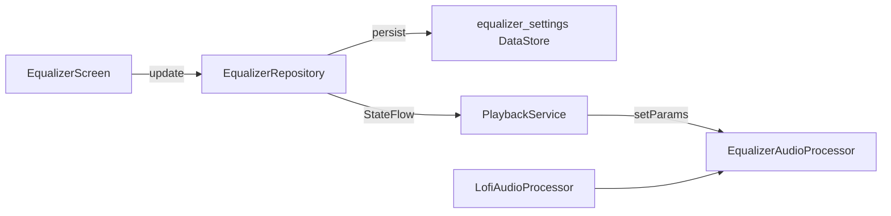

# Equalizer

> Status: Unreleased | Added in: Unreleased | Last updated: 2026-10-13

## Summary

A device-local 7-band equalizer with genre presets, a preamp, and Bass Boost / Virtualizer / Loudness switches. It runs as a custom Media3 audio processor after Lofi, so the sound is the same on every phone and applies to all listening (including Vocals/Instrumental stems). Free for everyone; not applied to Trim exports, stem files or Sing Along recordings.

## Key files

Paths are relative to `app/src/main/java/com/autoomstudio/mp3studio/` unless noted.

| File | Role |
|---|---|
| `playback/dsp/Biquad.kt` | Shared RBJ biquad (low/high-pass, peaking, low/high shelf). |
| `playback/equalizer/EqualizerEffect.kt` | DSP: bands, Bass Boost, Loudness, Virtualizer, preamp, headroom, soft limiter. |
| `playback/equalizer/EqualizerAudioProcessor.kt` | Media3 `BaseAudioProcessor` in the player sink. |
| `playback/equalizer/EqualizerState.kt` / `EqualizerBands.kt` / `EqualizerPreset.kt` | State model, band constants, built-in presets. |
| `data/equalizer/EqualizerRepository.kt` | DataStore persistence + `StateFlow` source of truth. |
| `ui/equalizer/EqualizerScreen.kt` | Concept UI: header switch, dropdown, vertical bands, preset grid, preamp, effect toggles. |
| `ui/equalizer/EqualizerViewModel.kt` | UI → repository. |
| `ui/equalizer/VerticalEqSlider.kt` | Custom vertical band slider. |
| `playback/PlaybackService.kt` | Installs Lofi then Equalizer processors; collects repository state. |

## How it works

- Chain order: Lofi → Equalizer → Media3 speed/pitch (`EffectRenderersFactory`).
- Inside the equalizer: 7 bands (60 Hz low shelf … 14 kHz high shelf) → Bass Boost shelf → Loudness shelves → Virtualizer (mid/side, high-passed side boost) → Preamp → soft limiter. Automatic headroom equals the largest positive combined boost.
- `EqualizerRepository` is created in `AppContainer`. The service applies `state.value` before building the player and collects updates so cold starts from the notification never play unequalized audio for long.
- Session extras include `equalizer_active` for the Now Playing Equalizer feature tile (on when enabled and not a flat Normal with extras off).
- Entry points: Now Playing Equalizer tile, Profile → Equalizer, and Playback settings → Equalizer (`ProfilePage.Equalizer`).

## Data and persistence

DataStore `equalizer_settings` (separate from `app_settings`):

| Key | Type | Default | Notes |
|---|---|---|---|
| `eq_enabled` | Boolean | `false` | Master on/off |
| `eq_gains` | String | flat | Seven comma-separated dB values |
| `eq_custom_gains` | String | flat | Last hand-tuned Custom curve |
| `eq_preset_id` | String | `normal` | Built-in id, `custom`, or `user:Name` |
| `eq_preamp` | Float | `0` | −12…+12 dB |
| `eq_bass_boost` | Boolean | `false` | |
| `eq_virtualizer` | Boolean | `false` | |
| `eq_loudness` | Boolean | `false` | |
| `eq_saved_presets` | String | empty | Line format `name\|gains\|preamp` |

Corrupt or missing values fall back to Normal with everything off.

## Manifest, permissions and notifications

None added. Uses the existing `PlaybackService` only.

## Tests

| Test | Covers |
|---|---|
| `playback/equalizer/EqualizerEffectTest` | Bypass, band relative boost, headroom, virtualizer mono/bass, 96 kHz, smoothing, preset ranges |
| `data/equalizer/EqualizerRepositoryCodecTest` | Gains and saved-preset encode/decode, corrupt fallback |

## Known limitations and TODOs

- No live frequency curve behind the sliders (PRD P1).
- No per-song / per-output-device settings.
- Not applied to Trim/ringtone export, stem files or Sing Along recordings.
- Preset and effect amounts may still be tuned by ear.

## Change history

| Date | Commit | Change |
|---|---|---|
| 2026-10-12 | - | Initial equalizer engine, persistence, concept UI and entry points (PRD v3.3). |
| 2026-10-13 | - | Now Playing entry is a feature tile (not a chip). See [playback](playback.md). |
