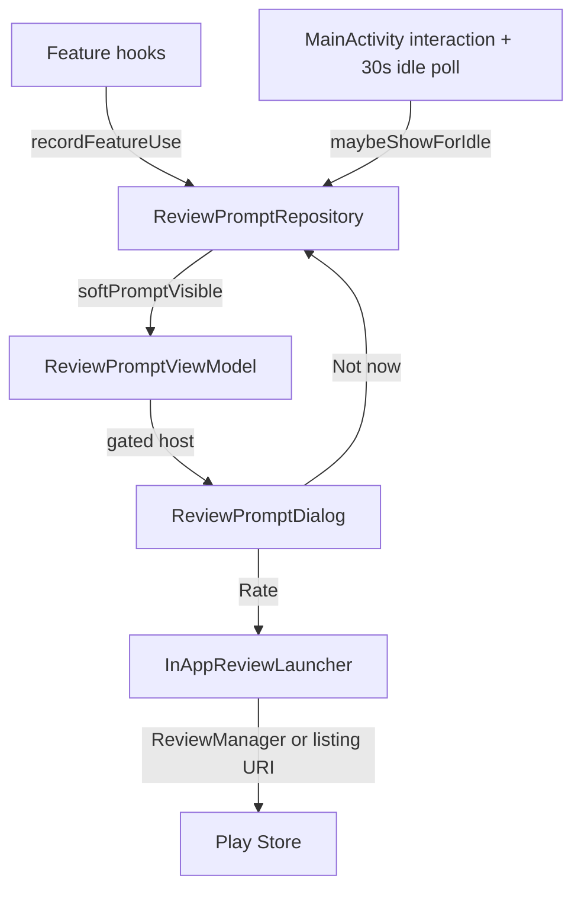

# In-app Play Store rating prompt

> Status: Unreleased | Added in: Unreleased | Last updated: 2026-11-14

## Summary

After the user has used a few studio features (or left the signed-in UI idle for 10 minutes), MP3 Studio shows a soft dialog asking them to rate the app. **Rate** launches Google Play’s In-App Review flow (with a Play Store listing fallback). **Not now** suppresses the prompt for 10 days. After a successful Rate launch attempt, the soft prompt never appears again on that install.

## Key files

Paths are relative to `app/src/main/java/com/autoomstudio/mp3studio/` unless they start with `app/`.

| File | Role |
|---|---|
| `data/review/ReviewPromptRepository.kt` | Feature-use / idle eligibility, `softPromptVisible`, dismiss and completed flags. |
| `data/review/InAppReviewLauncher.kt` | `ReviewManager` In-App Review; `market://` then HTTPS listing fallback. |
| `data/settings/AppSettings.kt` | DataStore keys for count, completed, dismissed-at, soft-prompt shown count (`ReviewPromptSettings`). |
| `di/AppContainer.kt` | `reviewPromptRepository`, `inAppReviewLauncher`. |
| `ui/review/ReviewPromptDialog.kt` | Material3 soft prompt with decorative looping five-star Lottie (`anim_review_stars`), Rate / Not now. |
| `res/raw/anim_review_stars.json` | Five-star pop/pulse animation (`primary` / `accent` layers for `ThemedLottie`). |
| `ui/review/ReviewPromptViewModel.kt` | Collects show state; Rate / Not now actions. |
| `ui/main/MainScreen.kt` | Hosts the dialog only when no blocking overlay. |
| `MainActivity.kt` | `onUserInteraction` → `noteInteraction()`; idle poll while signed in. |
| `ui/separation/SeparationViewModel.kt` | `recordFeatureUse()` after successful enqueue. |
| `ui/playback/PlaybackViewModel.kt` | Lofi on + `recordRingtoneMakerOpened()`. |
| `singalong/SingAlongSession.kt` | `recordFeatureUse()` when a session starts. |
| `ui/metronome/MetronomeViewModel.kt` | `recordFeatureUse()` after successful BPM detect. |

## How it works

- **Feature uses** (each once per successful/start action): vocal separation enqueue success; Lofi turned on; ringtone maker opened (`TrimMode.Ringtone`); sing-along session start; metronome BPM detect success. When the cumulative count reaches **3** and the user is eligible, `softPromptVisible` becomes true.
- **Idle**: `MainActivity.onUserInteraction` and the signed-in `LaunchedEffect` call `noteInteraction()`. Every 30 s, `maybeShowForIdle()` requests the soft prompt if **10 minutes** have passed since the last interaction (once per idle stretch).
- **Eligibility**: not `review_prompt_completed`, and either never dismissed or `now - review_prompt_dismissed_at_ms >= 10 days`.
- **Rate**: `markCompleted()` then `InAppReviewLauncher.launch`, which tries Play In-App Review then **always** opens `market://details?id=com.autoomstudio.mp3studio` (HTTPS fallback). Play may show no overlay under quota / on emulators; the listing is the guaranteed destination.
- **Soft dialog visuals**: `ReviewPromptDialog` shows a decorative looping five-star `ThemedLottie` (`R.raw.anim_review_stars`) above the message. Stars are not tappable; rating still goes through Play.
- **Not now** / dialog dismiss: `dismiss()` sets `review_prompt_dismissed_at_ms` and clears the soft prompt.
- **Overlay gates** (dialog not shown while any apply): separation notice, usage-limit upgrade sheet, missing-model dialog, active sing-along (not Idle/Saved/Failed), expanded Now Playing, billing checkout/result/cancel.

Play may still hide its own In-App Review UI due to quota; the soft prompt is still marked completed after a Rate launch attempt.

## Data and persistence

DataStore `app_settings` keys (also listed in [settings-and-about](settings-and-about.md)):

| Key | Type | Default | Meaning |
|---|---|---|---|
| `review_feature_use_count` | Int | `0` | Cumulative counted studio feature uses |
| `review_prompt_completed` | Boolean | `false` | True after Rate / review flow launch |
| `review_prompt_dismissed_at_ms` | Long | `0` | Epoch ms of last Not now; `0` if never |
| `review_soft_prompt_shown_count` | Int | `0` | Soft dialog show count (telemetry) |

## Manifest, permissions and notifications

No new permissions, services or receivers. Uses Play In-App Review (`com.google.android.play:review` / `review-ktx`). Soft prompt is Compose inside `MainActivity` while signed in.

## Tests

- `data/review/ReviewPromptRepositoryTest.kt`: feature threshold, 10-day dismiss cooldown, completed never shows, idle once-per-stretch and cooldown gating (fake clock + `ReviewPromptSettings`).
- No instrumented Play Review test (API is opaque).

## Known limitations and TODOs

- Play’s system dialog is not guaranteed to appear (quota / device / sideload).
- Soft prompt is only considered while the signed-in main UI is shown (not on the sign-in screen).

## Change history

| Date | Commit | Change |
|---|---|---|
| 2026-11-14 | - | Soft rating prompt, Play In-App Review, feature/idle triggers, DataStore cooldowns. |
| 2026-11-14 | - | Decorative looping five-star Lottie (`anim_review_stars`) in the soft prompt. |
| 2026-11-14 | - | Rate always opens the Play Store listing after the In-App Review attempt (no silent no-op). |
