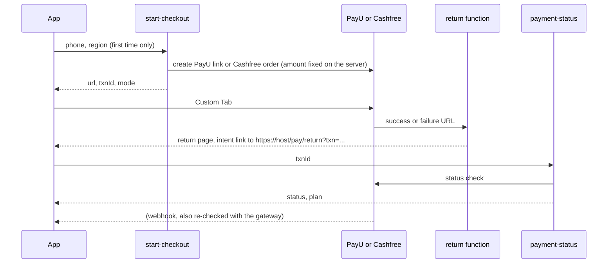

# Payments (PayU India + Cashfree International)

> Status: Unreleased | Added in: next version after 3.2.3 | Last updated: 2026-10-28

## Summary

Pro is paid through **PayU Payment Links for India** and **Cashfree Orders / Checkout for International**. India is ₹99 a month or ₹999 a year. International is $1.99 / $19.99 while `CASHFREE_ENV=live` (sandbox was INR because that merchant cannot settle USD). `entitlements` detects the country from the request IP (`detectedRegion`) and returns both price lists. Plans shows an India / International toggle that defaults to that region; a manual choice is stored as DataStore `billing_region_override` and sent as `start-checkout {region}`. The server maps region to a fixed amount and gateway — the app never invents a price. Renew / Fix / Switch stay on the existing subscription's currency. The app never talks to PayU or Cashfree, never holds their credentials and never decides Pro itself.

## Key files

Paths are relative to `app/src/main/java/com/autoomstudio/mp3studio/` unless they start with `supabase/`, `web/` or `app/`.

| File | Role |
|---|---|
| `data/billing/BillingModels.kt` | `BillingError` (server error codes), `BillingException`, `CheckoutLink`, `PaymentState`, `PaymentSummary`, `CancelResult`, `PaymentRecord`. |
| `data/billing/BillingBackend.kt` | `SupabaseBillingBackend`: `start-checkout`, `payment-status` and `subscription` Edge Functions, and payment history from the `payments` table (own rows through RLS, newest 50). Maps HTTP errors to `BillingError`. |
| `data/billing/BillingRepository.kt` | `startCheckout`, `confirm`, `cancel`, `history`, `clear`; `DataStorePendingPaymentStore` keeps the awaited transaction and `billing_region_override`. |
| `data/billing/PhoneNumber.kt` | `PhoneNumber.normalize` (Indian) and `normalizeIntl` (E.164 or Indian); `TxnId.parse`. |
| `data/plan/Entitlements.kt` | `BillingRegion`, `BillingCurrency`, `PriceList`, billing fields including `detectedRegion`, both price lists and `subscriptionCurrency`. |
| `ui/plans/BillingViewModel.kt` | Checkout sheet state, opening the link, the return and resume checks, cancel autopay. |
| `ui/plans/BillingHost.kt` | Root-level host: opens links in a Custom Tab (`androidx.browser`, https only), handles returns, checks on resume, shows the sheet, result screen and cancel dialog. |
| `ui/plans/CheckoutSheet.kt` | Monthly/Yearly picker, terms and Pay button for the selected region, +91 or E.164 phone, policy links. |
| `ui/plans/PaymentResultScreen.kt` | Full-screen result: confirming, success, failed, link expired, not completed, still processing, couldn't check, no browser. |
| `ui/plans/BillingStatus.kt` | `BillingStatusRules.of(...)`: the notice and buttons the Plans screen shows for each subscription state. |
| `ui/plans/PaymentReturnLink.kt` | Parses `https://<pay.returnHost>/pay/return?txn=...` App Links. |
| `ui/plans/PaymentHistoryScreen.kt` | Settings > Plans > Payment history, with a receipt dialog. |
| `ui/plans/PaymentText.kt` | `formatPrice` / `formatAmount` for INR and USD, date formatting, error and status text. |
| `supabase/functions/admin/` | Server-side Admin payment list, refund and revoke; see [admin](admin.md). No in-app Admin screens. |
| `supabase/functions/start-checkout/`, `payment-status/`, `payu-webhook/`, `payu-return/`, `cashfree-checkout/`, `cashfree-webhook/`, `cashfree-return/`, `subscription/`, `billing-jobs/` | Billing Edge Functions; see [backend](../backend.md#billing-payu). |
| `supabase/functions/_shared/payu.ts`, `cashfree.ts`, `billing.ts`, `checkout.ts`, `geo.ts`, `webhook.ts`, `jobs.ts`, `notifier.ts` | PayU and Cashfree clients, IP country lookup, checkout parse (`region`), shared billing flows. |
| `supabase/migrations/20261013000000_payu_billing.sql` to `20261015000000_billing_admin.sql` | Schema, verification, scheduled jobs and admin billing. |
| `supabase/migrations/20261017000000_yearly_plan.sql` | `billing_interval` on subscriptions and payments, `billing_price_paise(interval)`, `billing_period_end()`, the switch rule in `begin_checkout()`, and yearly-aware verification, renewals, entitlements and admin detail. |
| `supabase/migrations/20261021000000_intl_usd.sql` | `payments.currency` / `subscriptions.currency`, dual `billing_price_paise(interval, currency)`, E.164 phones, `begin_checkout(..., p_currency)`, currency check in `apply_payment_result`. |
| `supabase/functions/_shared/return_page.ts` | The return page `payu-return` serves after checkout, with an intent link back to the app. |
| `web/pay/return/index.html`, `web/.well-known/assetlinks.json` | Unpublished App Link page and Digital Asset Links template, for when `pay.returnHost` serves them. |

## How it works

### Checkout

- Go Pro (Plans screen or upgrade sheet), Fix payment, Set up autopay, Renew and the switch buttons all open `CheckoutSheet` (`CheckoutPurpose`). New purchases follow the Plans India / International toggle (IP default). Renew / Fix / Switch use the live subscription's currency. The phone field shows for India while `hasIndianPhone` is false, and for International while `hasPhone` is false.
- The sheet sends `start-checkout {interval, region}`. India (`in`) creates a PayU link. International (`intl`) creates a Cashfree order (manual, no autopay) and returns a `cashfree-checkout` URL that starts hosted Checkout with the `payment_session_id`. Live Cashfree is USD 199 / 1999. Omitted `region` uses the request IP. A live link is reused only when interval **and** currency match; a leftover PayU or Payment-Link URL is failed and replaced.
- `begin_checkout(..., p_currency)` refuses with `phone_required`, `invalid_phone`, `payment_in_progress`, `already_subscribed`, `switch_not_yet` or `mandate_update_pending`. A replace of an existing PayU row keeps that row's currency.

### Switching between monthly and yearly

A PayU mandate has a fixed cycle and amount, so a switch is a new checkout, not a change to the old mandate. With autopay on, "Switch to yearly" or "Switch to monthly" opens the sheet locked to the other interval (`CheckoutPurpose.SwitchInterval`). `begin_checkout()` answers `mandate_active`, so `startCheckout` cancels the old mandate with PayU and tries again. The new link is a `replace` payment whose period starts when the current paid period ends, so nothing is prorated or lost. A switch opens 31 days before the period end (`SWITCH_WINDOW_MS` in the app); earlier the server answers `switch_not_yet`. In practice monthly to yearly works any time and yearly to monthly in the last month of the year. If the user abandons the new link, Pro stays until the old period end with autopay off, and the Plans screen offers Set up autopay. In manual mode the user just picks the interval when renewing.
- The app saves `(userId, txnId)` in DataStore before opening the link, then opens it in a Custom Tab (any browser if Custom Tabs are missing; `NoBrowser` result if there's none).

### Confirmation

- PayU's success and failure URLs point at `payu-return`. Cashfree's `order_meta.return_url` is `cashfree-return?txn={order_id}` (Cashfree substitutes the order id). Both serve the same return page (`returnPageHtml`): "Payment received" or "Payment not completed" and a "Return to MP3 Studio" button. On Android the page opens `intent://<host of PAYU_RETURN_PAGE>/pay/return?result=...&txn=...#Intent;scheme=https;package=com.autoomstudio.mp3studio;end` straight away, and the button repeats it. Because the intent names the package, it reaches the `/pay/return` intent filter without App Link verification. `MainActivity.handleIntent` passes the transaction to `BillingViewModel.onReturned`. For a PayU POST the transaction comes from `udf1` (ours) before `txnid`.
- `BillingRepository.confirm` polls `payment-status` every 3 s (`POLL_INTERVAL_MS`) up to 10 times (`VISIBLE_ATTEMPTS`) while the result screen shows "Confirming". `payment-status` asks PayU or Cashfree (Cashfree links are recognised by `link_url`) and applies the answer through `apply_payment_result()`; the app only displays what comes back. A payment the gateway still reports as pending is checked until `resolveUntil` before it is failed.
- If the App Link didn't fire (browser closed, link verification missing), `onForeground` checks the stored transaction on every resume. A quiet check only surfaces Success; a return the user was waiting for shows every result.
- PayU runs each payment-link payment under a txnid it picks (for example `938632`) and puts our txnid in `udf1`. `PayuClient.checkPayment` therefore asks `verify_payment` for our txnid first (renewals use it), then for the PayU txnid a webhook named, accepted only when the answer's `udf1` is ours, and then for each transaction on the link (`GET /payment-links/{invoice}/txns`, OAuth scope `read_payment_links`). The answer is reported under our txnid, so `apply_payment_result()` matches it.
- `payu-webhook` saves every PayU notification to `webhook_log` first (secrets and card fields redacted) and then re-checks the payment with PayU. `classifyWebhook` takes our txnid from `udf1` when it looks like ours (`MP` or `RN` plus 20 hex digits). The reverse hash is still computed; a mismatch is logged as `_hashMismatch` but the event is processed anyway, because PayU's status answer decides and payment-link postbacks have failed the documented formula. Failed processing is retried by the `webhooks` job and flagged after 5 tries.
- `cashfree-webhook` does the same for Cashfree (`x-webhook-signature` = Base64 HMAC-SHA256 of `timestamp + raw body` with `CASHFREE_CLIENT_SECRET`). The body is only used to find our `MP…` txn id (`data.order.order_id`); the order is re-checked with `GET /pg/orders/{order_id}` before `apply_payment_result`. Logged rows carry `_gateway: "cashfree"` so the sweep job routes them correctly. `payment-status` treats `cashfree-checkout` URLs as Cashfree so it does not ask PayU. The dashboard URL is `https://securedbmp3.autoomstudio.com/functions/v1/cashfree-webhook` (no extra Coolify secret).

### Plans screen

`BillingStatusRules` turns `Entitlements.billing`, `pendingPayment`, `billingMode` and `paymentsEnabled` into one notice and its buttons:

| Notice | When | Buttons |
|---|---|---|
| Payments aren't available yet | `paymentsEnabled` is false (PayU secrets not set) | none |
| Payment pending | an open payment | Check payment |
| Autopay on (with the ₹99 or ₹999 amount) | active, autopay `on` | Switch to yearly (monthly plans) or Switch to monthly (yearly plans, last 31 days), Cancel autopay |
| Autopay not set | active, autopay `off` or `not_set` | Set up autopay |
| Renew soon | manual mode, within 7 days of expiry | Renew |
| Past due | a renewal debit failed, until `graceEnd` | Fix payment |
| Cancel pending | cancellation sent, PayU hasn't confirmed | none |
| Cancelled | autopay cancelled, Pro until `expiresAt` | Go Pro again |
| Mandate ending | the mandate ends within 30 days | Cancel autopay |
| Expired | the subscription expired | Go Pro again |

Pro granted by an Admin shows no billing notice. The Plans screen also shows the last payment and a Payment history link when there is one. The plan label reads "Pro · Monthly" or "Pro · Yearly" for PayU subscriptions (`PlanUiState.subscriptionInterval`), and history rows say "Pro, yearly renewal" for yearly debits.

### Renewals, expiry and cancellation (server)

Scheduled by pg_cron through `run_billing_job()` and the `billing-jobs` function: `webhooks` every 5 minutes, `sweep` every 15 (expired links, pending payments, pending refunds), `renewals` hourly (unconfirmed mandate cancellations, pre-debit notices, due debits), `expiry` hourly (period ends, grace ends, missed debits) and `notices` daily. In manual mode no debits or pre-debit notices are sent. Each run is recorded in `job_runs`.

Cancel autopay (`subscription` with `{action: "cancel"}`) stops renewals at once and asks PayU to revoke the mandate. Pro stays until the paid period ends. If PayU doesn't confirm, the answer is `cancel_pending` and the `renewals` job retries.

An Admin can also revoke a PayU subscription from the website dashboard (`revokeSubscription`, [admin](admin.md)): Pro ends at once (`revoke_subscription()` sets it `expired` now), renewals stop and any mandate is cancelled, retried by the `renewals` job if PayU doesn't confirm. Nothing is refunded.

Deleting the account cancels any live mandate first; if PayU refuses, deletion stops with `mandate_cancel_failed` ("We couldn't cancel your autopay...", [accounts](accounts.md)).

### Refunds and disputes

Only Admins can refund, from the Admin payments list or a user's page, and only a paid payment that has a PayU reference and no refund in progress. The request is recorded (`record_refund_request`) and its outcome is picked up by the `sweep` job or a refund webhook (`apply_refund_result`). A full refund of the payment that pays for the current period expires the subscription at once; a partial refund keeps Pro. Disputes from webhooks set `payments.dispute_status` (`apply_dispute`): `open` stops renewals but keeps Pro, `won` restores the payment, `lost` counts as a full refund.

## Data and persistence

- DataStore `billing`: `pending_payment_user`, `pending_payment_txn`, and `billing_region_override` (`in` | `intl`). Pending payment and the override are cleared on sign-out.
- DataStore `entitlements` (see [plans](plans.md)): includes `detectedRegion`, `pricesIn`, `pricesIntl`, `hasIndianPhone` and `subscriptionCurrency`. Older caches still decode (`ignoreUnknownKeys` / defaults).
- Server columns `subscriptions.currency` and `payments.currency` (`INR` | `USD`, default `INR`); `billing_interval` as before.
- Server tables `subscriptions` (PayU columns), `payments`, `webhook_log`, `job_runs`, `payment_events.txn_id` and `profiles.phone`: see [backend](../backend.md#billing-payu). No Room changes.
- The app stores no card, UPI or bank details, and neither does the server: only PayU's references, the method name and the mandate reference.

## Manifest, permissions and notifications

- `MainActivity` has an `android:autoVerify="true"` intent filter for `https://${payReturnHost}/pay/return`. The host comes from `pay.returnHost` in `local.properties` (default `autoomstudio.com`) and is also `BuildConfig.PAY_RETURN_HOST`.
- The App Link verifies only after `web/.well-known/assetlinks.json` is published on that host with the release and debug signing SHA-256 fingerprints (the file in the repo has placeholders). The return page's intent link doesn't need it, and the resume check still confirms payments.
- No new permissions; the PayU page runs in the browser, not in the app.
- Billing emails (renewal failed, grace ending, expired, autopay ending) are only logged for now (`LogNotifier`); no email provider is chosen.

## Tests

- Yearly Pro: `BillingViewModelTest` (Monthly default, the picked interval reaches the backend, a switch locks the other interval and carries the switch date), `BillingStatusRulesTest` (switch buttons and the 31-day window, prices), `EntitlementsResponseTest` (interval parsing, none for admin grants), `BillingRepositoryTest` (`switch_not_yet`, `invalid_interval`), Deno (`YEARLY` link payload, interval parsing) and pgTAP (yearly period and price, yearly first payment and renewal, monthly-to-yearly switch, `switch_not_yet`). The SQL and Deno tests have not been run yet.
- International USD: `BillingViewModelTest` (International checkout is manual and sends `region`, IP default when there is no override, stored override beats IP, Renew/Fix stay on the subscription currency), `BillingRepositoryTest` (override survives a new repository / process death; no override stays null), `BillingStatusRulesTest` (`formatPrice` for ₹99 / ₹999 / $1.99 / $19.99 and the USD save), `PhoneNumberTest.kt` (Indian vs E.164), `EntitlementsResponseTest` (`detectedRegion`, both price lists, `needsPhone` per region), `EntitlementsRepositoryTest` (offline cache keeps the last detected region). Deno: `geo_test.ts`, USD link payload without SI, `region` on checkout. pgTAP: dual prices, USD checkout, INR still needs an Indian mobile, same-currency link reuse, currency mismatch on `apply_payment_result`.
- `data/billing/BillingRepositoryTest.kt`: checkout remembers the transaction per user (and nothing on failure), confirm polls until PayU answers then refreshes the plan, an unsettled or offline payment stays remembered, an unknown transaction is forgotten, a return-link transaction doesn't touch the remembered one, cancel refreshes the plan.
- `ui/plans/BillingViewModelTest.kt`: the phone field (asked when missing locally or on the server), phone validation before calling the server, refusals staying on the sheet, opening the link and confirming on return, results following the server, the quiet resume check, offline after returning, cancel results.
- `ui/plans/BillingStatusRulesTest.kt`: the notice and buttons for each state, admin grants, the manual renewal window, and return-link parsing (host, scheme, path, transaction format).
- `data/plan/EntitlementsResponseTest.kt`: billing fields and enums from the `entitlements` JSON.
- Admin payment list, refund and revoke are covered in pgTAP (`billing_flow_test.sql`) and Deno `admin_test.ts`; the in-app `AdminViewModelTest` was removed.
- Deno, `supabase/functions/_shared/`: `payu_test.ts` (hashes, IST dates, INR and USD link payloads, parsers, config, the client against a fake fetch: token reuse, signed commands, the salt never sent; payment-link lookups by `udf1`, the link's transactions and `checkPayment`), `checkout_test.ts` (Indian and E.164 phones, `region` `in`/`intl`, status requests, job auth), `geo_test.ts` (public vs private IP, `X-Forwarded-For`, IN vs US vs failed lookup, `parseRegion`), `webhook_test.ts` (classification including payment-link postbacks, redaction, form and JSON bodies), `admin_test.ts` (billing actions).
- pgTAP: `supabase/tests/payments_test.sql` and `billing_flow_test.sql` (checkout rules, payment results, renewals, expiry, grace, cancellation, refunds, disputes, admin billing), run live with the new migrations rolled back (`run_live.ps1 -Pending`).
- Gaps: no end-to-end test against PayU's sandbox yet; no UI tests for the sheet, result screen or history.

## Known limitations and TODOs

- PayU endpoint paths, command names and field names follow PayU's documentation as of 2026-10 and must be checked against the sandbox before going live (`payu.ts` header).
- Deployed on 2026-10-10 with PayU **test** credentials and `PAYU_BILLING_MODE=manual`; real payments need the live credentials and `PAYU_ENV=live`. Whenever any PayU secret is missing, `paymentsEnabled` is false and the Plans screen shows "Payments aren't available yet." with Go Pro disabled.
- `pay.returnHost` (autoomstudio.com) doesn't serve `/pay/return` or `assetlinks.json`, so a plain `https://autoomstudio.com/pay/return` link opens the company website, not the app. Only the intent link from the return page opens the app. Some browsers may block the automatic open, in which case the user taps the button.
- Billing emails are only logged; GST invoices, partial refunds from the app and a web checkout are out of scope (PRD phase 6).
- Switching interval with autopay on cancels the old mandate before the new link is paid; an abandoned switch leaves autopay off until the user sets it up again. PayU's `YEARLY` billing cycle hasn't been tried in the sandbox yet.
- Live Cashfree keys are set (`CASHFREE_ENV=live`). Sandbox still cannot create USD orders. A missing or private client IP defaults to India; Coolify must pass `X-Forwarded-For`. The installed 1.0.1 app used INR fallbacks until this change; 1.0.2 (`versionCode` 13) shows $ on Plans.
- Catalog prices come from the entitlements payload; changing a price is a server change only.
- Receipts are in-app only (transaction ID, amount, date, method); there is no PDF.

## Change history

| Date | Commit | Change |
|---|---|---|
| 2026-10-28 | - | India monthly was ₹1 for a PayU test, then restored to ₹99 the same day. |
| 2026-10-23 | - | Play build 1.0.2 (`versionCode` 13) ships the Cashfree / $ Plans changes; 1.0.1 used INR fallbacks. |
| 2026-10-22 | - | Live Cashfree keys (`CASHFREE_ENV=live`). International catalog is $1.99 / $19.99 (`PriceList.International` 199 / 1999, `BillingRegion.International` is USD). |
| 2026-10-22 | - | International Cashfree switched from Payment Links to Orders + hosted Checkout (`cashfree-checkout` JS launcher, `POST /pg/orders`, `GET /pg/orders/{order_id}`). Leftover Payment Link `MPE5DC7FF3695240AC9BDD` failed so retry is unblocked. |
| 2026-10-22 | - | International checkout routed to Cashfree (`_shared/cashfree.ts`, `cashfree-webhook`, `cashfree-return`). Sandbox INR ₹99 / ₹999; `CASHFREE_ENV=live` uses USD $1.99 / $19.99. India stays on PayU. |
| 2026-10-22 | - | International catalog temporarily ₹99 / ₹999 INR (`currencyOf` always INR, `PRICES_INTL` matches India) because the PayU India test merchant displays USD links as ₹. |
| 2026-10-22 | - | Live `start-checkout` / `_shared` / `entitlements` deployed (backups `*.bak-20261022-intl-usd`). International Pay now sends `region=intl` through to PayU as $1.99 USD. The leftover 3-arg `begin_checkout` wrapper still maps old callers to monthly INR. |
| 2026-10-21 | - | International USD Pro ($1.99 / $19.99): IP `detectedRegion`, India / International toggle (`billing_region_override`), `start-checkout {region}`, USD Payment Links without SI, E.164 phone. Migration `20261021000000_intl_usd.sql` applied live (after yearly). |
| 2026-10-10 | - | Yearly Pro at ₹999: Monthly/Yearly picker, yearly autopay mandate, switching between intervals at the end of the paid period (migration `20261017000000_yearly_plan.sql`, not yet applied). The Monthly and Yearly cards are the same height. |
| 2026-10-10 | - | After checkout, `payu-return` serves the return page and opens the app through an intent link, instead of redirecting to autoomstudio.com, which showed the company website. |
| 2026-10-10 | - | Admin revoke subscription: ends PayU Pro now and cancels any mandate, without a refund. |
| 2026-10-21 | - | In-app Admin payment screens removed; revoke and refund stay on the server for the website dashboard ([admin](admin.md)). |
| 2026-10-10 | - | Payment-link payments are verified under PayU's own txnid (from the webhook or the link's transactions); a webhook hash mismatch no longer drops the event. First test payment confirmed. |
| 2026-10-10 | - | Deployed to the live server in PayU test mode with manual renewal. |
| 2026-10-10 | - | PayU Payment Links: checkout with autopay or manual mode, server verification, Plans billing status, cancel autopay, renewals and expiry jobs, refunds and disputes, payment history and receipts, admin payments. |
